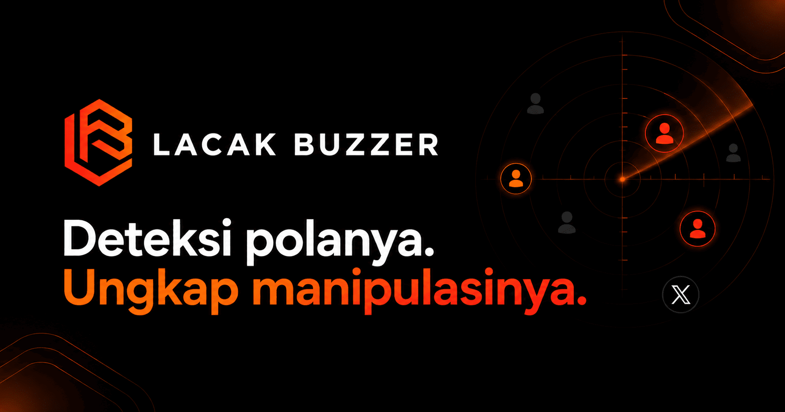
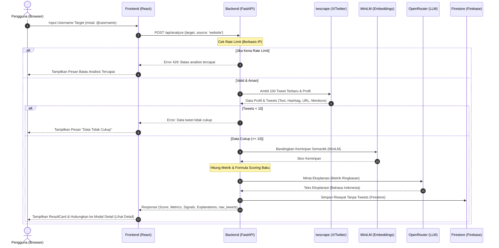
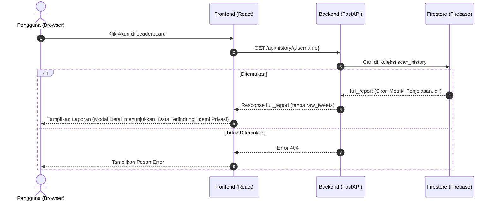

# Lacak Buzzer




## Daftar Isi
- [Deskripsi Proyek](#deskripsi-proyek)
- [Anggota Kelompok](#anggota-kelompok)
- [Detail Tech Stack](#detail-tech-stack)
- [Arsitektur Sistem & Alur Request (Workflows)](#arsitektur-sistem--alur-request-workflows)
  - [Arsitektur Sistem](#arsitektur-sistem)
  - [Diagram Alur Analisis Baru (Request Flow)](#diagram-alur-analisis-baru-request-flow)
  - [Diagram Alur Mengambil Riwayat (History Flow)](#diagram-alur-mengambil-riwayat-history-flow)
- [Metodologi & Formula Penilaian (Scoring & Feature Extraction)](#metodologi--formula-penilaian-scoring--feature-extraction)
- [Struktur Proyek](#struktur-proyek)
- [Tabel Keamanan (Security Table)](#tabel-keamanan-security-table)
- [Instalasi & Cara Menjalankan](#instalasi--cara-menjalankan)
- [Status X Bot & Contoh Respon](#status-x-bot--contoh-respon)
- [Komunitas & Tata Kelola](#komunitas--tata-kelola)
- [Catatan Keamanan](#catatan-keamanan)

---

## Deskripsi Proyek
**Lacak Buzzer** adalah sistem *Minimum Viable Product* (MVP) ringan yang menganalisis profil dan aktivitas akun X/Twitter untuk memberikan **Indikator Risiko Amplifikasi Terkoordinasi**. Sistem ini memperkirakan pola perilaku seperti repetisi, intensitas aktivitas, dan interaksi tanpa mengklaim akun tersebut palsu, berbayar, atau berafiliasi secara definitif.

## Anggota Kelompok
| Nama | Tugas (Backend/Frontend) |
|---|---|
| [Ridwan](https://github.com/Yogs4R) | Backend 1 |
| [Dandy](https://github.com/dandy63609) | Backend 2 |
| [Naufal](https://github.com/naufalid755) | Frontend 1 |
| [Falen](https://github.com/luckywtrike-rgb) | Frontend 2 |

## Detail Tech Stack

### 1. Frontend
*   **React.js (v18)**: Framework utama untuk pembuatan Single Page Application (SPA).
*   **Vite**: Alat build super cepat untuk manajemen aset dan *hot module replacement* (HMR).
*   **CSS Kustom / Tailwind CSS**: Desain visual responsif, premium, dan gelap (dark mode) dengan transisi halus.
*   **Cloudflare Pages**: Media hosting statis untuk frontend.

### 2. Backend (API)
*   **Python (v3.12)**: Bahasa pemrograman utama backend.
*   **FastAPI**: Framework web asinkron dengan performa tinggi yang menyediakan endpoint REST API.
*   **Uvicorn**: Server web ASGI untuk menjalankan FastAPI.
*   **Hugging Face Spaces**: Platform hosting backend menggunakan kontainer Docker.

### 3. Layanan Pihak Ketiga & ML Lokal
*   **Firebase Firestore**: Database dokumen NoSQL untuk menyimpan statistik global dan riwayat pemindaian (`scan_history`).
*   **twscrape**: Kakas scraping data X/Twitter secara terprogram tanpa API X resmi.
*   **all-MiniLM-L6-v2**: Model Sentence-Transformers lokal untuk memproses kemiripan semantik antar-tweet.
*   **OpenRouter (LLM)**: Model AI eksternal untuk menyusun eksplanasi perilaku dalam Bahasa Indonesia secara ramah dan terstruktur.

---

## Arsitektur Sistem & Alur Request (Workflows)

### Arsitektur Sistem
Aplikasi ini berjalan secara terpisah (*decoupled*):
*   **Frontend Client** terhubung ke **FastAPI Backend** via HTTP/HTTPS.
*   Backend menggunakan penyimpanan lokal untuk rate-limiting metadata (stateless JSON files) dan terhubung ke **Firebase Firestore** untuk leaderboard.
*   Backend memanggil model AI lokal untuk semantik, dan **OpenRouter API** untuk eksplanasi teks.

### Diagram Alur Analisis Baru (Request Flow)
Berikut adalah visualisasi alur request ketika pengguna melakukan analisis akun baru:



### Diagram Alur Mengambil Riwayat (History Flow)
Berikut adalah alur saat pengguna mengeklik akun dari papan Leaderboard (tanpa scraping ulang):



---

## Metodologi & Formula Penilaian (Scoring & Feature Extraction)

Sistem **Lacak Buzzer** dirancang transparan, deterministik, dan dapat diuji secara terbuka (*white-box*). Seluruh proses penilaian profil dilakukan melalui dua tahap: **Ekstraksi Fitur Perilaku** ([backend/services/feature_extraction.py](backend/services/feature_extraction.py)) dan **Formula Pembobotan Risiko Tetap** ([backend/services/scoring.py](backend/services/scoring.py)).

> [!IMPORTANT]
> **Prinsip Keamanan Produk:**  
> Skor yang dihasilkan adalah **Indikator Risiko Amplifikasi Terkoordinasi (0–100)** berbasis pola statistik perilaku. Formula ini **bukan bukti hukum/ilmiah** bahwa suatu akun adalah buzzer, bot bayaran, palsu, memiliki agenda politik, atau terkoordinasi secara jahat.

```text
Skor ini adalah indikator risiko berbasis pola perilaku, bukan bukti bahwa akun tersebut terkoordinasi, palsu, dibayar, atau memiliki niat tertentu.
```

---

### 1. Ekstraksi Fitur Statistik Perilaku

Sistem mengumpulkan maksimum 100 tweet terkini dari target dan mengekstrak 7 parameter perilaku:

#### A. Kemiripan Semantik Antar-Pesan ($S_{\text{sim}}$)
Menggunakan model Sentence-Transformers lokal `sentence-transformers/all-MiniLM-L6-v2` (berjalan hemat memori pada CPU 2GB). Setiap teks tweet diubah menjadi vektor *embedding* $e_i \in \mathbb{R}^{384}$. Tingkat kemiripan dihitung dari rata-rata *Cosine Similarity* seluruh pasangan tweet unik:

$$\text{CosineSim}(e_i, e_j) = \frac{e_i \cdot e_j}{\|e_i\|_2 \|e_j\|_2}$$

$$S_{\text{sim}} = \frac{1}{\binom{N}{2}} \sum_{1 \le i < j \le N} \text{CosineSim}(e_i, e_j), \quad S_{\text{sim}} \in [0.0, 1.0]$$

*Interpretasi: Nilai tinggi mengindikasikan akun sering mengulang narasi atau template teks serupa secara masif (copy-paste / blast messaging).*

#### B. Kepadatan Tagar ($H_{\text{avg}}$)
Rata-rata jumlah tagar (*hashtags*) per tweet:

$$H_{\text{avg}} = \frac{\sum_{i=1}^{N} \text{Count}(\text{Hashtags}_i)}{N}$$

#### C. Intensitas Aktivitas Harian ($A_{\text{rate}}$)
Frekuensi rata-rata posting per hari berdasarkan rentang waktu tweet tertua dan terbaru:

$$\text{Active Days} = \max\left(1.0, \frac{t_{\max} - t_{\min}}{86400}\right)$$

$$A_{\text{rate}} = \frac{N}{\text{Active Days}}$$

#### D. Rasio Tautan ($R_{\text{url}}$) & Media ($R_{\text{photo}}$)
Proporsi posting yang memuat link eksternal atau lampiran gambar/video:

$$R_{\text{url}} = \frac{\sum [\,\text{has\_url}_i\,]}{N}, \quad R_{\text{photo}} = \frac{\sum [\,\text{has\_media}_i\,]}{N}$$

#### E. Perilaku Interaksi ($R_{\text{mention}}$ & $R_{\text{reply}}$)
Proporsi posting yang menyebut akun lain (*mention*) atau merupakan balasan (*reply*):

$$R_{\text{mention}} = \frac{\sum [\,\text{has\_mention}_i\,]}{N}, \quad R_{\text{reply}} = \frac{\sum [\,\text{is\_reply}_i\,]}{N}$$

#### F. Parameter Keaslian Akun ($P_{\text{risk}}$)
Menilai risiko awal berdasarkan umur akun sejak tanggal pendaftaran dan kelengkapan bio:

$$\text{Age}_{\text{days}} = \frac{t_{\text{now}} - t_{\text{created}}}{86400}$$

$$P_{\text{risk}} = \begin{cases} 70, & \text{jika } \text{Age}_{\text{days}} < 90 \\ 0, & \text{lainnya} \end{cases} + \begin{cases} 30, & \text{jika Bio kosong} \\ 0, & \text{lainnya} \end{cases}$$

#### G. Entropi Interval Waktu Posting ($E$)
Mengukur tingkat keacakan jeda waktu posting $\Delta t_i = t_{i} - t_{i-1}$ ke dalam 9 *time bins* (0–1 jam, 1–2 jam, ..., >24 jam) menggunakan **Shannon Entropy**:

$$H = -\sum_{k=1}^{K} p_k \log_2(p_k), \quad E = \frac{H}{\log_2(K)} \in [0.0, 1.0]$$

*Interpretasi: Entropi rendah ($E \to 0$) berarti jeda waktu antar-tweet sangat konsisten dan terjadwal secara mekanis (otomatisasi / cron bot).*

---

### 2. Normalisasi Metrik ke Skala Baku (0–100)

Sebelum pembobotan, seluruh metrik mentah dipetakan ke skala terstandardisasi $[0, 100]$:

| Komponen Metrik ($M_i$) | Rumus Normalisasi Internal | Bobot ($w_i$) | Indikator |
|:---|:---|:---:|:---|
| **Semantic Similarity** ($M_{\text{sim}}$) | $S_{\text{sim}} \times 100$ | **30%** | Tingkat pengulangan narasi pesan |
| **Hashtag Density** ($M_{\text{hash}}$) | $\min\left(\frac{H_{\text{avg}}}{4} \times 100, 100\right)$ | **20%** | Kepadatan spam tagar kampanye |
| **Activity Intensity** ($M_{\text{act}}$) | $\min\left(\frac{A_{\text{rate}}}{80} \times 100, 100\right)$ | **15%** | Intensitas posting harian abnormal |
| **Media & URL Ratio** ($M_{\text{media}}$) | $(R_{\text{url}} \times 60) + (R_{\text{photo}} \times 40)$ | **10%** | Penyebaran tautan keluar dan media |
| **Interaction Behavior** ($M_{\text{int}}$) | $(R_{\text{mention}} \times 50) + (R_{\text{reply}} \times 50)$ | **10%** | Pola interaksi balasan/mention terarah |
| **Profile Risk** ($M_{\text{prof}}$) | $\min(P_{\text{risk}}, 100)$ | **10%** | Akun baru dibuat (<90 hari) & bio kosong |
| **Interval Regularity** ($M_{\text{intv}}$) | $(1 - E) \times 100$ | **5%** | Keteraturan jeda posting (jadwal otomatis) |

---

### 3. Formula Skor Dasar (Raw Score)

Kombinasi linear berbobot dari seluruh metrik terstandardisasi:

$$S_{\text{base}} = \sum_{i=1}^{7} w_i M_i$$

$$S_{\text{base}} = 0.30 M_{\text{sim}} + 0.20 M_{\text{hash}} + 0.15 M_{\text{act}} + 0.10 M_{\text{media}} + 0.10 M_{\text{int}} + 0.10 M_{\text{prof}} + 0.05 M_{\text{intv}}$$

$$S = \min(S_{\text{base}}, 100)$$

---

### 4. Mekanisme Anti-False-Positive (Reducers)

Untuk mencegah akun personal aktif, jurnalis, atau kreator konten mendapatkan skor risiko tinggi secara tidak sengaja, sistem menerapkan pengurang skor otomatis (*penalty reducers*):

```python
diversity_score = 1 - semantic_similarity

# 1. Reduksi Keberagaman Topik: narasi tweet sangat bervariasi
if diversity_score > 0.6:
    final_score *= 0.70

# 2. Reduksi Aktivitas Rendah: frekuensi posting wajar di bawah 5 tweet/hari
if posts_per_day < 5:
    final_score *= 0.80

# 3. Reduksi Percakapan Alami: bukan akun yang terus-menerus reply/mention terarah
if reply_ratio < 0.3 and mention_ratio < 0.3:
    final_score *= 0.85
```

Skor akhir dibatasi dalam rentang $[0, 100]$ dan dibulatkan:

$$\text{Skor Akhir} = \text{round}\Big(\max\big(0, \min(S, 100)\big)\Big)$$

---

### 5. Klasifikasi Kategori Risiko (Risk Bands) & Kepercayaan

| Rentang Skor | Kategori Risiko (*Risk Band*) | Karakteristik Perilaku |
|:---:|:---:|:---|
| **0 – 35** | 🟢 **Rendah** | Aktivitas organik, topik percakapan bervariasi, pola waktu alami. |
| **36 – 65** | 🟡 **Sedang** | Terdeteksi pola repetisi ringan atau intensitas posting tertentu. |
| **66 – 85** | 🟠 **Tinggi** | Terdeteksi kemiripan pesan kuat, kepadatan tagar padat, atau pola terjadwal. |
| **86 – 100** | 🔴 **Ekstrem** | Kombinasi repetisi teks sangat tinggi, akun baru, aktivitas posting sangat intensif. |

#### Tingkat Kepercayaan (*Confidence Level*)
- **< 10 Tweet:** *Insufficient Data* (sistem menolak kalkulasi skor demi menjaga keadilan analisis).
- **10 – 49 Tweet:** **Rendah** (*"Kepercayaan hasil rendah karena jumlah tweet yang tersedia terbatas."*).
- **$\ge$ 50 Tweet:** **Normal** (data cukup representatif untuk evaluasi statistik).

---

## Struktur Proyek

```text
lacak-buzzer/
├── .github/
│   ├── changelog-config.json         # Konfigurasi kategori changelog otomatis
│   └── workflows/
│       ├── auto-release.yml          # Workflow Github Action untuk rilis versi
│       └── advanced-security.yml     # Pemindaian Gitleaks (Secrets) & Trivy (Container)
├── frontend/                         # Website SPA (React + Vite)
│   ├── public/
│   │   ├── metadata.json             # Meta data aplikasi
│   │   ├── robots.txt                # Aturan indexing mesin pencari
│   │   ├── sitemap.xml               # Peta situs pencarian
│   │   └── _headers                  # Aturan CSP dan header keamanan (Cloudflare)
│   ├── src/
│   │   ├── components/
│   │   │   ├── Footer.jsx            # Komponen catatan/disclaimer footer
│   │   │   ├── Header.jsx            # Komponen navigasi atas
│   │   │   ├── ResultCard.jsx        # Komponen penampil hasil skor risiko + detail modal
│   │   │   ├── SearchBar.jsx         # Komponen pencarian username
│   │   │   └── TweetDetailsModal.jsx # Pop-up rincian tweet & metrik detail (See Details)
│   │   ├── pages/
│   │   │   └── Home.jsx              # Halaman utama Lacak Buzzer dengan Skeleton Loaders
│   │   ├── App.jsx                   # Root komponen UI
│   │   ├── index.css                 # Global CSS (Tailwind directives)
│   │   └── main.jsx                  # Entry point aplikasi React
│   ├── index.html                    # Kerangka HTML utama
│   ├── package.json                  # Dependensi library NPM Node.js
│   ├── postcss.config.js             # Konfigurasi postcss (Tailwind)
│   ├── tailwind.config.js            # Konfigurasi Tailwind CSS
│   ├── vite.config.js                # Konfigurasi Vite bundler
│   └── wrangler.toml                 # Konfigurasi Cloudflare Pages
├── backend/                          # Backend API & Bot (FastAPI)
│   ├── api/
│   │   ├── analyze.py                # Endpoint `/analyze` FastAPI
│   │   └── leaderboard.py            # Endpoint stats, leaderboard, & detail history
│   ├── bot/
│   │   ├── mention_parser.py         # Ekstraktor username dari teks tweet bot
│   │   └── x_bot.py                  # Proses monitoring dan membalas tweet (Bot X)
│   ├── data/                         # Folder internal data (e.g. rate limit JSON)
│   ├── schemas/
│   │   └── analysis.py               # Schema validasi pydantic (Model Data)
│   ├── services/
│   │   ├── explanation.py            # Generator penjelasan via OpenRouter LLM
│   │   ├── feature_extraction.py     # Logika metrik hashtag, dll (NLP/Math)
│   │   ├── firebase_service.py       # Integrasi database Firestore & global stats
│   │   ├── rate_limits.py            # Pengecekan limit akses harian
│   │   ├── scoring.py                # Implementasi formula penilaian baku
│   │   └── scraper.py                # Wrapper twscrape untuk mengambil tweets
│   ├── tests/
│   │   ├── test_analyze_api.py       # Unit test endpoint analyze dan leaderboard
│   │   ├── test_bot_mentions.py      # Unit test parser mention bot
│   │   ├── test_confidence.py        # Unit test kalkulasi kepercayaan
│   │   ├── test_firebase_service.py  # Unit test integrasi Firebase Firestore
│   │   ├── test_rate_limits.py       # Unit test rate limiter
│   │   └── test_scoring.py           # Unit test algoritma scoring & reducers
│   ├── Dockerfile                    # Konfigurasi container Hugging Face Spaces
│   ├── main.py                       # Entry point ASGI FastAPI (Uvicorn)
│   └── requirements.txt              # Daftar pustaka Python backend
├── docs/                             # Dokumen progres dan manajerial
│   └── PROGRESS.md                   # Pelacakan status rilis MVP
├── AGENTS.md                         # Dokumen PRD / Panduan agen AI proyek
├── BRAND_RESOURCES.md                # Panduan identitas visual & copywriting
├── DESIGN.md                         # Spesifikasi teknis desain & UI komponen
├── DESIGN_RESEARCH.md                # Logika riset desain (ATM Method)
├── .env.example                      # Template variabel environment rahasia
├── .gitignore                        # Daftar file yang diabaikan Git
└── Procfile                          # Konfigurasi perintah runner production
```

---

## Tabel Keamanan (Security Table)

Berikut adalah mekanisme keamanan yang diterapkan pada proyek Lacak Buzzer untuk menjamin integritas data dan proteksi sistem:

| Fitur / Komponen | Ancaman / Risiko | Solusi & Mekanisme Proteksi |
|:---|:---|:---|
| **Kredensial API & Firebase** | Kebocoran kunci otentikasi di repositori publik | Kredensial disimpan dalam `.env` dan `backend/secrets/` — keduanya diabaikan melalui `.gitignore`. Pipeline GitHub Actions dilengkapi dengan **Gitleaks** untuk menyaring kebocoran rahasia secara otomatis. |
| **Docker Container** | Celah keamanan (vulnerabilities) sistem operasi di _image_ | Integrasi **Trivy Image Scanner** pada CI workflow untuk memindai OS/library di backend. Direktori `data/` berjalan dengan izin `755` (bukan `777`) untuk membatasi akses write hanya pada proses aplikasi. |
| **Stateless Tweets** | Pelanggaran privasi / memori server penuh | **Raw tweets** tidak disimpan ke Firestore maupun dikirim ke LLM OpenRouter. Data hanya hidup sementara di memori selama kalkulasi, lalu langsung dibersihkan. |
| **Rate Limiting — Website** | Pengurasan kuota token OpenRouter & Scraping (DDOS) | Rate limiting lokal berbasis IP: maks 5 permintaan sukses per menit per IP. Menggunakan `X-Forwarded-For` header untuk membaca IP klien yang sesungguhnya di balik reverse proxy (Hugging Face). |
| **Rate Limiting — Bot X** | Spam analisis & duplikasi mention | Tiga lapis limit bot: maks 10 reply global/menit, maks 5 request per requester/menit, maks 1 analisis per target/menit. Operasi baca-tulis file JSON dilindungi **threading.Lock** untuk mencegah _race condition_ pada concurrent requests. |
| **Validasi Input Username** | Injeksi karakter aneh / input tak terbatas | Setiap username divalidasi dengan regex `[A-Za-z0-9_]` dan dibatasi maksimum 50 karakter sebelum diteruskan ke scraper. |
| **Validasi Mention ID (Bot)** | Manipulasi format `mention_id` / DoS pada file JSON | `mention_id` divalidasi sebagai string numerik Twitter (maks 25 digit). List `bot_processed_mentions` dibatasi maksimum 500 entri terakhir agar file tidak tumbuh tak terbatas. |
| **Privasi Log ke Firestore** | Penyimpanan IP address pengguna secara permanen di database | Identifier (IP/username requester) dihapus dari execution logs sebelum disimpan ke Firestore. |
| **CORS** | Akses API dari domain tidak sah | `allow_origins` di-whitelist secara eksplisit. Method dibatasi hanya `GET` & `POST`, header dibatasi hanya `Content-Type` & `Authorization`. |
| **Manipulasi Skor** | Penilaian bias atau salah diagnosis | Penerapan logika **Anti-False-Positive Reducers** secara permanen. Pengurangan skor otomatis jika variansi semantik tinggi, total tweet harian kecil, atau aktivitas interaksi minim. |
| **Bot Polling Backoff** | Rate limit ban dari Twitter akibat polling agresif saat error | Bot menerapkan **exponential backoff** saat terjadi error polling: jeda berlipat ganda per error (1× → 2× → 4× → 8×) dan reset kembali ke normal setelah berhasil. |
| **Dependency Pinning** | Pembaruan library tak terduga yang membawa breaking changes atau CVE baru | Semua dependency Python di-pin ke versi spesifik di `requirements.txt`. **Dependabot** dikonfigurasi untuk membuka PR otomatis setiap ada versi terbaru (setiap Senin). |

---

## Instalasi & Cara Menjalankan

### Panduan Kolaborasi
Bagi anggota kelompok yang baru bergabung, ikuti langkah-langkah berikut:

1. **Clone Repositori**
   ```bash
   git clone https://github.com/Yogs4R/lacak-buzzer.git
   cd lacak-buzzer
   ```

2. **Alur Kerja Git (2 Opsi)**

   **Opsi A: Simple Workflow (Pemula)**
   Gunakan alur ini jika tidak ingin pusing dengan *branching*.
   - Siapkan perubahan: `git add .`
   - Simpan perubahan: `git commit -m "pesan singkat tentang fitur/perbaikan"`
   - Ambil *update* teman: `git pull origin main`
   - Unggah pekerjaan: `git push origin main`

   **Opsi B: Advanced Workflow (Standar Industri)**
   Gunakan alur ini jika sudah terbiasa dengan Git.
   - Ambil *update* terbaru: `git pull origin main`
   - Buat *branch* fitur: `git checkout -b nama-tugas`
   - Simpan perubahan: `git add .` lalu `git commit -m "feat: nama tugas"`
   - Unggah & gabungkan: `git push origin nama-tugas` lalu buat *Pull Request* di GitHub.
### Panduan Kredensial & Berkas Konfigurasi

Semua berkas kredensial sensitif diabaikan oleh Git demi keamanan. Pengembang yang melakukan *clone* atau *fork* dapat menyiapkan berkas-berkas berikut menggunakan template `.example` yang telah disediakan:

| Berkas Asli (Sensitif/Lokal) | Berkas Template (.example) | Tujuan Impor / Penempatan | Fungsi & Keterangan |
|:---|:---|:---|:---|
| `backend/secrets/firebase-key.json` | `backend/secrets/firebase-key.json.example` | Letakkan di `backend/secrets/` atau copy isinya ke env `FIREBASE_CREDENTIALS` | Service Account Google Cloud / Firebase Firestore untuk riwayat pemindaian & leaderboard. *(Opsional: jika tidak diisi, backend otomatis jalan dalam mode offline tanpa database).* |
| `backend/twitter_accounts.json` | `backend/twitter_accounts.json.example` | Copy seluruh string JSON ke env `TWITTER_ACCOUNTS_JSON` di `.env` / Hugging Face Secrets | Kredensial dan session cookies (`auth_token` & `ct0`) untuk scraping X/Twitter tanpa API berbayar. |
| `backend/accounts.txt` | `backend/accounts.txt.example` | Digunakan sebagai input CLI `twscrape add_accounts` | Format teks baris (`user:pass:email:email_pass`) untuk inisialisasi akun scraper secara manual via terminal. |
| `accounts.db` | *(Dihasilkan Otomatis)* | Direktori backend atau `TWS_DATA_DIR` | Basis data SQLite sesi Twitter. Terbuat secara otomatis saat backend dijalankan jika `TWITTER_ACCOUNTS_JSON` terisi. |
| `backend/data/rate_limits.json` | *(Dihasilkan Otomatis)* | Direktori `backend/data/` | Cache rate limit (IP website & mention bot). Terbuat secara otomatis saat runtime oleh aplikasi. |

---

### Cara 1: Menjalankan dengan Docker Compose (Direkomendasikan & Paling Mudah)

Anda dapat menjalankan seluruh stack (Backend FastAPI + Frontend Nginx SPA) secara mandiri hanya dengan satu perintah:

```bash
# 1. Salin template konfigurasi environment
cp .env.example .env

# 2. Isi OPENROUTER_API_KEY dan TWITTER_ACCOUNTS_JSON pada file .env

# 3. Jalankan seluruh layanan
docker compose up --build
```
- **Website (Frontend):** [http://localhost:3000](http://localhost:3000)
- **API Backend & Dokumentasi Swagger:** [http://localhost:8000/docs](http://localhost:8000/docs)

---

### Cara 2: Menjalankan Manual (Tanpa Docker)

#### A. Backend (API)

**Langkah 1: Setup Awal (Cukup dilakukan sekali)**
Buka PowerShell, lalu jalankan perintah berikut untuk membuat *virtual environment* menggunakan Python 3.12:
```powershell
cd backend
py -3.12 -m venv venv
```
*(Jika perintah `py` tidak dikenali, gunakan `python -m venv venv` asalkan versi Python adalah 3.12).*

**Langkah 2: Menjalankan Backend**
```powershell
cd backend
# Aktifkan virtual environment
.\venv\Scripts\Activate.ps1

# Install atau perbarui dependensi
pip install -r requirements.txt

# Jalankan server API
uvicorn main:app --reload
```

**Perintah twscrape CLI (Jika Menyiapkan Akun via `accounts.txt`):**
```powershell
# 1. Tambah akun dari file accounts.txt
twscrape add_accounts accounts.txt username:password:email:email_password

# 2. Login seluruh akun
twscrape login_accounts

# 3. Cek status akun
twscrape accounts

# 4. Relogin atau reset locks jika terblokir sementara
twscrape relogin
twscrape reset_locks
```

**Keluar dari Virtual Environment:**
```powershell
deactivate
```

#### B. Frontend (Website)
```bash
cd frontend
npm install
npm run dev
```

---

## Status X Bot & Contoh Respon

> [!NOTE]
> **Status X Bot Saat Ini: AKTIF / ENABLED**  
> Menggunakan kombinasi `twscrape` dan `twikit` dengan injeksi *cookies* dari variabel environment JSON, Bot X ini dapat berjalan 100% gratis tanpa perlu berlangganan API X (Pay-Per-Use).

### Format Respon X Bot
Jika bot diaktifkan secara mandiri dengan kredensial *cookies* yang valid, format balasan otomatis di Twitter/X adalah sebagai berikut:

```text
Risiko: Tinggi | Skor: 74/100

- Kemiripan pesan cukup tinggi
- Pola penggunaan tagar terlihat padat

⚠️ Indikator pola perilaku, bukan bukti koordinasi.

🔍 Cek analisis lengkap & coba gratis di sini:
https://lacakbuzzer.web.id atau mentions @lacakbuzzer
```
*Catatan: Bot X membatasi panjang teks agar ketat berada di bawah batas 280 karakter Twitter/X dengan pemotongan otomatis.*

### Cara Menggunakan Bot X
> [!TIP]
> **Cukup mention `@lacakbuzzer` beserta username target di X/Twitter!**
> Contoh: `@lacakbuzzer analisis akun @detikcom`
> Bot akan otomatis membalas dengan hasil analisis dalam beberapa saat.

## Komunitas & Tata Kelola
Kami menyambut baik partisipasi komunitas dalam mengembangkan dan menjaga integritas proyek ini:
- 📜 [Kode Etik (CODE_OF_CONDUCT.md)](CODE_OF_CONDUCT.md) — Standar perilaku dan komitmen lingkungan inklusif.
- 🤝 [Panduan Kontribusi (CONTRIBUTING.md)](CONTRIBUTING.md) — Alur kerja git, standar pengujian, dan pedoman etika analisis.
- 🔒 [Kebijakan Keamanan (SECURITY.md)](SECURITY.md) — Tata cara pelaporan kerentanan secara privat dan bertanggung jawab.
- 👥 [Daftar Kontributor (CONTRIBUTORS.md)](CONTRIBUTORS.md) — Pengembang inti dan kontributor komunitas.

## Catatan Keamanan
*Skor yang dihasilkan adalah indikator risiko berbasis pola perilaku, bukan bukti bahwa akun tersebut terkoordinasi, palsu, dibayar, atau memiliki niat tertentu.*

