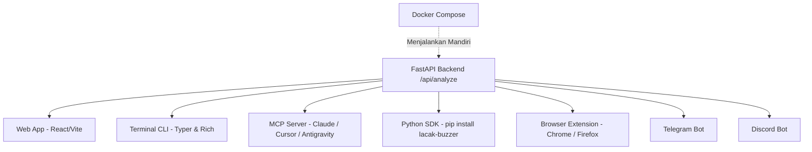

# Rencana Pengembangan & Ekosistem Multi-Platform (Lacak Buzzer)

Dokumen ini memuat peta jalan (*roadmap*), arsitektur, dan spesifikasi rencana implementasi untuk memperluas ekosistem **Lacak Buzzer** ke berbagai platform: Bot Interaktif (Telegram/Discord), CLI, Model Context Protocol (MCP), Python SDK, Browser Extension, opsi *Full Local Self-Hosted*, serta integrasi dokumentasi publik pada situs web.

---

## 🗺️ Ringkasan Roadmap Ekosistem



---

## 1. Status X Bot (Twitter/X) & Alternatif Interaktif (Telegram & Discord)

Langkah ini dirancang untuk memetakan kendala bot Twitter/X saat ini serta menyediakan jalur interaksi instan tanpa ketergantungan pada batasan ketat dan biaya komersial X API.

### A. Status & Tantangan Teknis X Bot Saat Ini (`backend/bot/x_bot.py`)

Saat ini integrasi bot otomatis untuk Twitter/X (`@lacakbuzzer`) masih berada dalam **tahap eksperimen dan belum stabil (Work In Progress)**. Meskipun arsitektur dual-channel telah dibangun dan dependensi telah dimigrasikan ke `twifork>=2.4.0`, sistem masih mengalami kendala pada tahap pembacaan (*read/detection*):

#### 1. Kendala Mekanisme Read (Deteksi Mention)
* **Kanal 1 (Notifikasi Akun via Twifork):**
  - Error `ClientTransaction` sudah berhasil diperbaiki menggunakan `twifork`.
  - **Hambatan:** Twitter Web memiliki fitur bawaan *Quality Filter* (Filter Kualitas) serta filter notifikasi dari akun yang tidak saling follow atau akun baru. Mention dari akun publik sering kali disembunyikan oleh sistem keamanan Twitter sehingga tidak muncul di feed notifikasi internal bot.
* **Kanal 2 (Pencarian Publik via twscrape):**
  - Endpoint GraphQL `SearchTimeline` Twitter menerapkan restriksi ketat terhadap IP data center/cloud (seperti IP Hugging Face Spaces).
  - Akun scraping sering kali mengalami status 404 atau *temporary cooldown* (49/50 requests) saat melakukan pencarian kata kunci `@lacakbuzzer`.

#### 2. Status Mekanisme Write (Pengiriman Balasan)
* Karena tahap *read* belum menangkap mention baru di cloud, eksekusi pemanggilan analisis backend dan pengiriman balasan belum terpicu di lingkungan produksi.
* **Rencana Pengujian Khusus:** Membuat script validasi mandiri (*write dry-run & live test*) untuk memastikan cookie sesi (`auth_token`, `ct0`) akun `@lacakbuzzer` masih valid untuk memposting tweet tanpa memicu verifikasi CAPTCHA atau penangguhan akun.

#### 3. Rencana Tindak Lanjut untuk X Bot
1. **Pengaturan Akun X:** Memastikan setelan *Settings > Notifications > Filters* pada akun `@lacakbuzzer` telah mematikan *"Quality filter"* dan *"Filter notifications from people you don't follow"*.
2. **Pengujian Residential vs Cloud:** Menguji bot di lingkungan lokal (menggunakan IP koneksi internet rumah/residensial) untuk melihat apakah deteksi mention berjalan lancar dibanding IP cloud hosting.
3. **Penyediaan CLI Test:** Menyediakan utilitas CLI lokal untuk mensimulasikan mention spesifik tanpa bergantung pada polling background.

#### 4. Perbaikan di Kode Polling (`x_bot.py`)
* **Loop tidak lagi membeku saat cooldown twscrape.** Sebelumnya, saat semua akun twscrape terkena cooldown `SearchTimeline`, twscrape menunggu sampai akun terbuka (~15 menit) dan seluruh loop bot (termasuk kanal notifikasi) ikut berhenti. Sekarang kanal search langsung dilewati (`raise_when_no_account=True` + timeout 45 detik) dan kanal notifikasi tetap berjalan.
* **Tidak membalas ulang mention lama setelah restart.** ID mention yang sudah ditangani disimpan di `backend/data/x_bot_state.json`, dan mention yang lebih tua dari 30 menit diabaikan (atur dengan `X_BOT_MAX_MENTION_AGE`, dalam detik). Penanda `last_seen_id` dihapus karena bisa membuang mention dari kanal search yang terindeks lebih lambat dari kanal notifikasi.
* **Pesan internal tidak diposting.** Error backend `Duplicate mention` sebelumnya ikut diposting sebagai balasan publik; sekarang diabaikan.
* **Timeout panggilan analisis dinaikkan dari 30 menjadi 120 detik.** Scraping sendiri boleh memakan waktu sampai 40 detik, jadi timeout lama sering membuat bot membalas "Maaf, analisis belum bisa diproses" padahal backend berhasil.
* **Balasan ke tweet bot sendiri diabaikan**, agar komentar orang lain di thread balasan bot tidak memicu analisis ulang terhadap akun yang disebut di thread tersebut.
* **Mode diagnostik:** jalankan dari folder `backend/` untuk melihat apa yang ditangkap tiap kanal tanpa memanggil analisis dan tanpa memposting:
  ```bash
  python -m bot.x_bot --bot-username lacakbuzzer --check
  ```
  Bandingkan hasilnya di koneksi rumah dan di Hugging Face Space untuk membuktikan apakah masalahnya IP cloud atau filter notifikasi akun.

---

### B. Perbandingan Keuntungan: X Bot vs Alternatif Platform

| Parameter | Twitter/X Bot (Dalam Perbaikan) | Telegram Bot (Rekomendasi Utama) | Discord Bot |
|---|---|---|---|
| **Status Operasional** | **Eksperimental / Belum Stabil** | **Stabil & Terjamin** | **Stabil & Terjamin** |
| **Biaya API** | Berbayar (Pay-Per-Use) / Rentan Blockir | **Gratis 100% Selamanya** | **Gratis 100% Selamanya** |
| **Batas Karakter** | 280 karakter (sangat ketat) | **4.096 karakter** (sangat longgar) | **2.000 karakter** (longgar) |
| **Kemudahan Pembuatan** | Sulit (Kredensial cookies & session) | **Sangat Mudah** (Instan via @BotFather) | **Mudah** (via Discord Developer Portal) |
| **Kemampuan Menampilkan Hasil** | Terbatas (Tanpa penjelasan AI) | **Lengkap** (Bisa menampilkan semua metrik + AI explanation) | **Lengkap** (Bisa format Rich Embed yang indah + AI explanation) |
| **Mekanisme Event** | Polling scraping rentan blokir | Webhook resmi / Long-polling resmi | WebSocket gateway resmi (`discord.py`) |

### B. Telegram Bot (Pilihan Utama)
- **Library:** `pyTelegramBotAPI==4.15.0`
- **Konfigurasi:** Simpan token di `.env` (`TELEGRAM_BOT_TOKEN`).
- **Perintah:** `/analyze <username>` atau `/lacak <username>`.
- **Format Keluaran:** Rich Markdown memuat skor total, 7 metrik perilaku, dan eksplanasi AI.

### C. Discord Bot (Pilihan Komunitas)
- **Library:** `discord.py==2.3.2`
- **Konfigurasi:** Simpan token di `.env` (`DISCORD_BOT_TOKEN`).
- **Perintah:** Slash command `/analyze target:<username>`.

---

## 2. CLI (Command-Line Interface) & MCP Server

Mengizinkan developer, analis data, dan agen AI mengakses analisis Lacak Buzzer langsung dari terminal maupun editor kode (Cursor, Claude Desktop, Antigravity, VS Code).

### A. Arsitektur Client Ringan (Lightweight Wrapper)
Alih-alih menduplikasi proses scraping dan model transformer di mesin pengguna, CLI dan MCP dirancang sebagai *lightweight client* yang mengonsumsi endpoint REST API FastAPI (`/api/analyze`).
- **Opsi Fleksibilitas:** Menyediakan flag `--api-url` (default ke server cloud publik, atau diarahkan ke `http://localhost:8000` untuk pengguna *self-hosted*).

### B. Spesifikasi CLI
- **Library:** `typer` (CLI runner) dan `rich` (formatting tabel, panel, gauge progress warna di terminal).
- **Contoh Perintah:**
  ```bash
  # Analisis cepat akun
  lacak-buzzer analyze detikcom

  # Analisis dengan URL API custom
  lacak-buzzer analyze jokowi --api-url http://localhost:8000

  # Output dalam format JSON mentah
  lacak-buzzer analyze detikcom --json
  ```
- **Contoh Tampilan Terminal (Rich Output):**
  - Panel header dengan target username dan status profil.
  - Gauge / progress bar skor risiko: `[████████░░] 74/100 (Tinggi)`.
  - Tabel rincian metrik: Semantik Repetisi, Kepadatan Tagar, Pola Waktu, dsb.
  - Kotak narasi eksplanasi AI.

### C. Spesifikasi MCP Server (Model Context Protocol)
- **Library:** `mcp` / `fastmcp`
- **Penyedia Tool untuk AI Agent:**
  ```python
  from mcp.server.fastmcp import FastMCP
  import httpx

  mcp = FastMCP("Lacak Buzzer")

  @mcp.tool()
  async def analyze_twitter_account(username: str, api_url: str = "https://lacakbuzzer-lacak-buzzer-backend.hf.space") -> dict:
      """Menganalisis profil akun X/Twitter untuk mendeteksi indikator risiko amplifikasi terkoordinasi."""
      async with httpx.AsyncClient() as client:
          res = await client.post(f"{api_url}/api/analyze", json={"target": username, "source": "mcp"})
          return res.json()
  ```
- **Integrasi Klien:**
  Pengguna cukup menambahkan konfigurasi MCP di Claude Desktop atau Cursor config:
  ```json
  {
    "mcpServers": {
      "lacak-buzzer": {
        "command": "uvx",
        "args": ["lacak-buzzer-mcp"]
      }
    }
  }
  ```

---

## 3. Python SDK (`lacak-buzzer`)

Pustaka pip resmi untuk mempermudah integrasi terprogram bagi analis data, peneliti OSINT, dan akademisi:

```python
from lacak_buzzer import LacakBuzzerClient

client = LacakBuzzerClient(api_url="https://lacakbuzzer.web.id")
result = client.analyze("username_target")

print(f"Skor Risiko: {result.score} ({result.risk_label})")
for metric in result.metrics:
    print(f"- {metric.name}: {metric.value}%")
```

---

## 4. Browser Extension (Chrome / Firefox / Edge)

Ekstensi peramban berbasis **Manifest V3** untuk memberikan akses inspeksi akun instan tanpa meninggalkan linimasa X/Twitter:

- **Alur Kerja:**
  1. Konten skrip (*content script*) mendeteksi halaman profil `x.com/<username>`.
  2. Menyisipkan tombol kecil **"🔍 Cek Indikator Lacak Buzzer"** di sebelah tombol *Follow*.
  3. Saat diklik, ekstensi mengirim request ke API dan menampilkan kartu *popover* mengambang berisi skor risiko dan peringatan disclaimer etika.

---

## 5. Rencana Dokumentasi Publik di Website

Apakah situs web [lacakbuzzer.web.id](https://lacakbuzzer.web.id) membutuhkan menu dokumentasi? **Ya, sangat direkomendasikan!**

### A. Kebutuhan & Nilai Tambah
1. **Transparansi Metodologi (Algoritma & Formula):**  
   Pengunjung dapat memahami formula 7 metrik pembentuk skor risiko, sehingga terhindar dari kesalahpahaman bahwa skor adalah tuduhan sepihak.
2. **Katalog Panduan API & Ekosistem:**  
   Menyediakan panduan lengkap untuk:
   - Penggunaan REST API publik (`/api/analyze`, `/api/leaderboard`).
   - Panduan instalasi dan penggunaan CLI (`lacak-buzzer analyze <user>`).
   - Panduan konfigurasi MCP Server untuk Cursor dan Claude Desktop.
   - Kebijakan Rate Limiting dan Etika Penggunaan.

### B. Alternatif Desain Implementasi di Web
1. **Halaman `/docs` Internal (React Page):**  
   Membuat rute baru `lacakbuzzer.web.id/docs` dengan tata letak dokumentasi modern (sidebar navigasi, syntax highlight kode, tab panduan CLI/MCP).
2. **Tautan Langsung ke FastAPI Swagger / Redoc:**  
   Menambahkan tombol *"API Docs"* di navbar/footer yang mengarah langsung ke endpoint OpenAPI interaktif backend.
