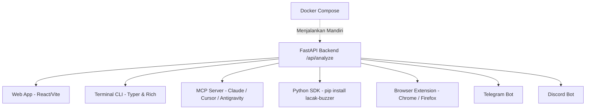

# Rencana Pengembangan & Ekosistem Multi-Platform (Lacak Buzzer)

Dokumen ini memuat peta jalan (*roadmap*), arsitektur, dan spesifikasi rencana implementasi untuk memperluas ekosistem **Lacak Buzzer** ke berbagai platform: Bot Interaktif (Telegram/Discord), CLI, Model Context Protocol (MCP), Python SDK, Browser Extension, opsi *Full Local Self-Hosted*, serta integrasi dokumentasi publik pada situs web.

---

## 🗺️ Ringkasan Roadmap Ekosistem



---

## 1. Alternatif Bot Interaktif: Telegram & Discord

Langkah ini dirancang untuk menyediakan interaksi instan tanpa ketergantungan pada batasan ketat dan biaya komersial X API.

### A. Perbandingan Keuntungan

| Parameter | Twitter/X Bot (Nonaktif) | Telegram Bot (Rekomendasi) | Discord Bot |
|---|---|---|---|
| **Biaya API** | Berbayar (Pay-Per-Use) | **Gratis 100% Selamanya** | **Gratis 100% Selamanya** |
| **Batas Karakter** | 280 karakter (sangat ketat) | **4.096 karakter** (sangat longgar) | **2.000 karakter** (longgar) |
| **Kemudahan Pembuatan** | Sulit (Butuh review 24 jam & kartu kredit) | **Sangat Mudah** (Instan via @BotFather) | **Mudah** (via Discord Developer Portal) |
| **Kemampuan Menampilkan Hasil** | Terbatas (Tanpa penjelasan AI) | **Lengkap** (Bisa menampilkan semua metrik + AI explanation) | **Lengkap** (Bisa format Rich Embed yang indah + AI explanation) |
| **Model Polling/Webhook** | Polling via twscrape + write Tweepy | Long-polling ringan atau Webhook gratis | WebSocket gateway (`discord.py`) |

### B. Telegram Bot (Pilihan Utama)
- **Library:** `pyTelegramBotAPI==4.15.0`
- **Konfigurasi:** Simpan token di `.env` (`TELEGRAM_BOT_TOKEN`).
- **Perintah:** `/analyze <username>` atau `/lacak <username>`.
- **Format Keluaran:** Rich Markdown memuat skor total, 7 metrik perilaku, dan eksplanasi AI.

### C. Discord Bot (Pilihan Komunitas)
- **Library:** `discord.py==2.3.2`
- **Konfigurasi:** Simpan token di `.env` (`DISCORD_BOT_TOKEN`).
- **Perintah:** Slash command `/analyze target:<username>`.

---

## 2. CLI (Command-Line Interface) & MCP Server

Mengizinkan developer, analis data, dan agen AI mengakses analisis Lacak Buzzer langsung dari terminal maupun editor kode (Cursor, Claude Desktop, Antigravity, VS Code).

### A. Arsitektur Client Ringan (Lightweight Wrapper)
Alih-alih menduplikasi proses scraping dan model transformer di mesin pengguna, CLI dan MCP dirancang sebagai *lightweight client* yang mengonsumsi endpoint REST API FastAPI (`/api/analyze`).
- **Opsi Fleksibilitas:** Menyediakan flag `--api-url` (default ke server cloud publik, atau diarahkan ke `http://localhost:8000` untuk pengguna *self-hosted*).

### B. Spesifikasi CLI
- **Library:** `typer` (CLI runner) dan `rich` (formatting tabel, panel, gauge progress warna di terminal).
- **Contoh Perintah:**
  ```bash
  # Analisis cepat akun
  lacak-buzzer analyze detikcom

  # Analisis dengan URL API custom
  lacak-buzzer analyze jokowi --api-url http://localhost:8000

  # Output dalam format JSON mentah
  lacak-buzzer analyze detikcom --json
  ```
- **Contoh Tampilan Terminal (Rich Output):**
  - Panel header dengan target username dan status profil.
  - Gauge / progress bar skor risiko: `[████████░░] 74/100 (Tinggi)`.
  - Tabel rincian metrik: Semantik Repetisi, Kepadatan Tagar, Pola Waktu, dsb.
  - Kotak narasi eksplanasi AI.

### C. Spesifikasi MCP Server (Model Context Protocol)
- **Library:** `mcp` / `fastmcp`
- **Penyedia Tool untuk AI Agent:**
  ```python
  from mcp.server.fastmcp import FastMCP
  import httpx

  mcp = FastMCP("Lacak Buzzer")

  @mcp.tool()
  async def analyze_twitter_account(username: str, api_url: str = "https://lacakbuzzer-lacak-buzzer-backend.hf.space") -> dict:
      """Menganalisis profil akun X/Twitter untuk mendeteksi indikator risiko amplifikasi terkoordinasi."""
      async with httpx.AsyncClient() as client:
          res = await client.post(f"{api_url}/api/analyze", json={"target": username, "source": "mcp"})
          return res.json()
  ```
- **Integrasi Klien:**
  Pengguna cukup menambahkan konfigurasi MCP di Claude Desktop atau Cursor config:
  ```json
  {
    "mcpServers": {
      "lacak-buzzer": {
        "command": "uvx",
        "args": ["lacak-buzzer-mcp"]
      }
    }
  }
  ```

---

## 3. Python SDK (`lacak-buzzer`)

Pustaka pip resmi untuk mempermudah integrasi terprogram bagi analis data, peneliti OSINT, dan akademisi:

```python
from lacak_buzzer import LacakBuzzerClient

client = LacakBuzzerClient(api_url="https://lacakbuzzer.web.id")
result = client.analyze("username_target")

print(f"Skor Risiko: {result.score} ({result.risk_label})")
for metric in result.metrics:
    print(f"- {metric.name}: {metric.value}%")
```

---

## 4. Browser Extension (Chrome / Firefox / Edge)

Ekstensi peramban berbasis **Manifest V3** untuk memberikan akses inspeksi akun instan tanpa meninggalkan linimasa X/Twitter:

- **Alur Kerja:**
  1. Konten skrip (*content script*) mendeteksi halaman profil `x.com/<username>`.
  2. Menyisipkan tombol kecil **"🔍 Cek Indikator Lacak Buzzer"** di sebelah tombol *Follow*.
  3. Saat diklik, ekstensi mengirim request ke API dan menampilkan kartu *popover* mengambang berisi skor risiko dan peringatan disclaimer etika.

---

## 5. Opsi Full Local / Self-Hosted Stack (`docker-compose.yml`)

Memungkinkan siapapun menjalankan seluruh sistem Lacak Buzzer secara mandiri di mesin lokal atau server pribadi:

- **Komponen Docker Compose:**
  - `backend`: Menjalankan FastAPI, Sentence-Transformers lokal, dan worker twscrape.
  - `frontend`: Menjalankan build Nginx/Vite yang otomatis terhubung ke backend lokal.
- **Berkas Konfigurasi yang Dibutuhkan:**
  - Sediakan `.env.example` yang memuat template akun scraper X (`TWITTER_COOKIES`) dan `OPENROUTER_API_KEY`.
- **Keuntungan:** Tidak membebani kuota API maupun instance Hugging Face produksi.

---

## 6. Rencana Dokumentasi Publik di Website

Apakah situs web [lacakbuzzer.web.id](https://lacakbuzzer.web.id) membutuhkan menu dokumentasi? **Ya, sangat direkomendasikan!**

### A. Kebutuhan & Nilai Tambah
1. **Transparansi Metodologi (Algoritma & Formula):**  
   Pengunjung dapat memahami formula 7 metrik pembentuk skor risiko, sehingga terhindar dari kesalahpahaman bahwa skor adalah tuduhan sepihak.
2. **Katalog Panduan API & Ekosistem:**  
   Menyediakan panduan lengkap untuk:
   - Penggunaan REST API publik (`/api/analyze`, `/api/leaderboard`).
   - Panduan instalasi dan penggunaan CLI (`lacak-buzzer analyze <user>`).
   - Panduan konfigurasi MCP Server untuk Cursor dan Claude Desktop.
   - Kebijakan Rate Limiting dan Etika Penggunaan.

### B. Alternatif Desain Implementasi di Web
1. **Halaman `/docs` Internal (React Page):**  
   Membuat rute baru `lacakbuzzer.web.id/docs` dengan tata letak dokumentasi modern (sidebar navigasi, syntax highlight kode, tab panduan CLI/MCP).
2. **Tautan Langsung ke FastAPI Swagger / Redoc:**  
   Menambahkan tombol *"API Docs"* di navbar/footer yang mengarah langsung ke endpoint OpenAPI interaktif backend.
